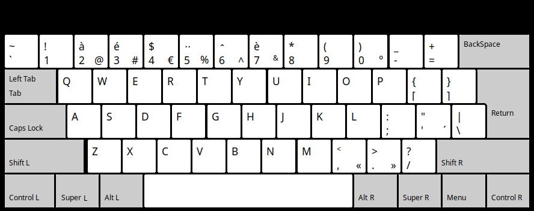
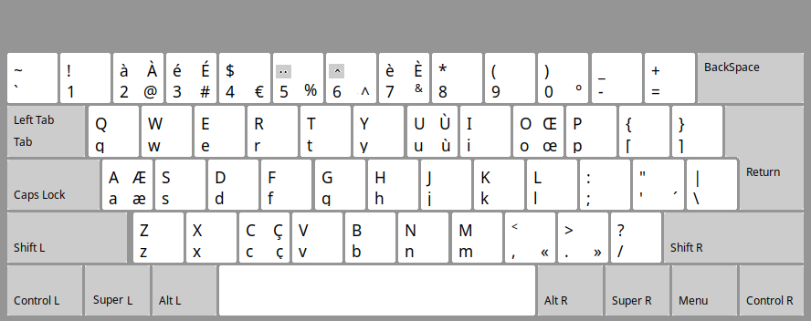

# Simplified French Keyboard Layout (frs) 

## Overview

This repository provides an enhanced French character layout for the QWERTY keyboard.

The improvements aim to make typing in French on a QWERTY keyboard easier.

### Description of "frs" keyboard layout.
It is a QWERTY keyboard layout enhanced with some French characters 

- Accented characters : `à, é, è, ù`
- Ligatures : `æ, œ` 
- Cedilla : `ç` 
- Dead keys, shown in small gray square

Other French accented characters are typed using `dead keys`. For example, `ï` as 
`dead_diaeresis + i`,  
and `ô` as `dead_circumflex + o` ...

### Bilingual `"frs"` French-English QWERTY keyboard 



### The `"frs"` French keyboard layout



## Repository Structure 

```
.
├── linux/ 
│     └── symbols/
│           └── frs					# simplified French keyboard layout for linux
│     └── rules/
│           └── evdev.xml			# for GNOME, Plasma (KDE)
│     └── xsessionrc				# a minimal ~/.xsessionrc for LXDE 
│     └── frs-variant.png			# image of "frs" variant, numbers with `SHIFT_KEY`
├── windows/
│     └── frs-install/				# simplified French keyboard layout for Windows
│       └── setup.exe ...           # created using MSKLC.exe 
│     └── frsl-install/...			# "frsl" ("frs" variant), numbers with `SHIFT_KEY`
│     └── images/ 			        # images 
├── README.md
└── frs.png                     
└── frs-qw.png                      # Layout of the physical French QWERTY keyboard (frs)

```

## Quick Start

To implement the `"frs"` keyboard layout 


### Linux

#### GNOME or Plasma (KDE)
1. Copy the `frs` file to `/usr/share/X11/xkb/symbols/` folder 
on your local system
2. Copy the `evdev.xml` file to 
`/usr/share/X11/xkb/rules/` folder on your local system. 
3. Run `udevadm trigger --subsystem-match=input --action=change` or reboot 
 
#### LXDE
1. Copy the `frs` file to `/usr/share/X11/xkb/symbols/` folder
on your local system
2. Add the command line  
 `setxkbmap "us,frs" -variant "," -option "grp:lwin_toggle,grp_led:caps";`  
to your `~/.xsessionrc` file.
3. Execute `logout` or `reboot`
- Remark : for frs (variant), in 2. replace `","` by `",l"` 
 
### Windows
- Copy `frs-install/` folder and execute `setup.exe`.
- Remark : `"install/"` folder created using `Microsoft Keyboard Layout Creator` (MSKLC.exe)

## License
This repository is licensed under `MIT License`. 
